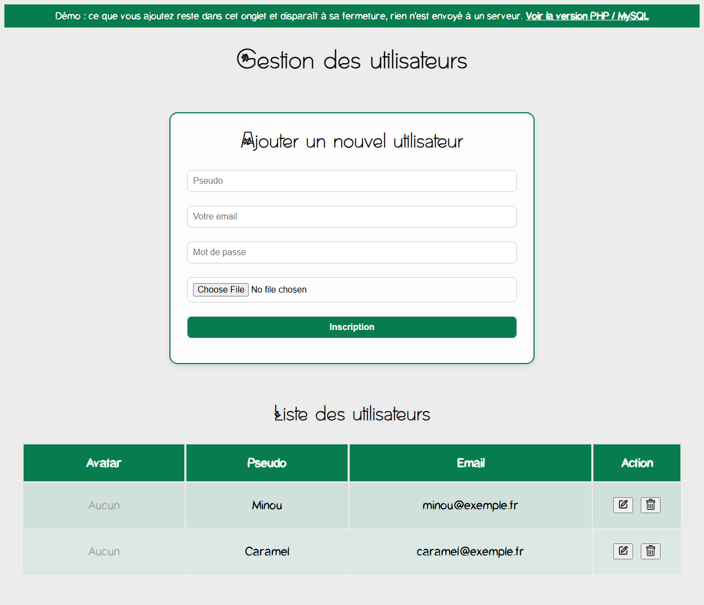

# Gestion des utilisateurs

A small user management app in PHP and MySQL: add, edit and delete users, with a pseudo, an email,
a password and an avatar. Made during my web developer training.

**[▶ Try the online demo](https://suzonz.github.io/Liste-Utilisateurs/)**

> The online demo is a browser-only copy of the page (same HTML and CSS, in `docs/`):
> what you add stays in your browser tab and disappears when you close it. Nothing is sent to a server.
> The real app, in PHP with MySQL, is at the root of this repository.



The app is in French.

## What it shows

- **CRUD in PHP with PDO**: every query is a prepared statement
- **Passwords hashed** with `password_hash`
- **Avatar upload**: the file must really be an image (JPG, PNG, GIF or WEBP, checked with `getimagesize`),
  2 MB max; the old avatar is deleted when it is replaced or when the user is deleted
- **Safe output**: everything is escaped with `htmlspecialchars` when displayed
- **Edit form in a modal**, opened from the list
- The `uploads/` folder refuses to run any script (`.htaccess`)

## Run it locally

1. Create a MySQL database named `yolo` (or another name, see below) and import `database.sql`.
2. Serve the folder with PHP, for example with Laragon, or: `php -S localhost:8000`.
3. Open <http://localhost:8000>.

The database settings come from environment variables, with local defaults:

| Variable | Default |
|---|---|
| `DB_HOST` | `127.0.0.1` |
| `DB_NAME` | `yolo` |
| `DB_USER` | `root` |
| `DB_PASSWORD` | *(empty)* |
| `APP_DEBUG` | errors shown; set `0` online to hide them |

## Project structure

```
index.php         the page: add form, user list, edit modal
db.php            database connection and actions (add, edit, delete, avatar upload)
database.sql      the user table
assets/           styles, fonts, icons
uploads/          avatars sent by users (not versioned, except its .htaccess)
docs/             online demo for GitHub Pages (browser only, no server)
screenshots/      images used in this README
```

## Credits

- App and code: **Suzonz**
